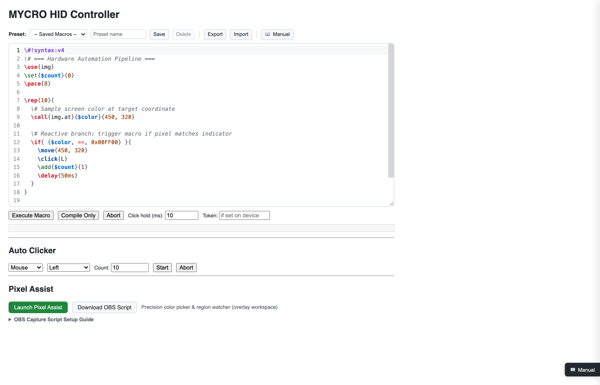
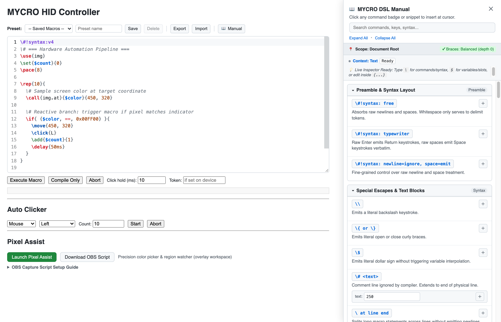
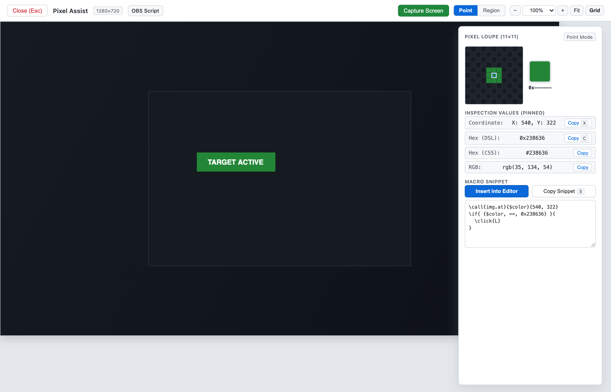

# MYCRO

> **Powerful, programmable, full-featured USB HID simulator for ESP32** — ditch fragile software macros and build driverless, hardware-grade automation pipelines with an on-chip VM and Web IDE.

[](https://circuitpython.org)
[-orange)](https://www.espressif.com)
[](LICENSE)

---

**MYCRO** is a standalone, hardware-level USB Human Interface Device (HID) automation platform built on the ESP32-S3. It emulates standard USB keyboards, mice, and media controls at the physical layer, freeing your workflows from fragile OS-level macro software, driver hooks, or anti-cheat detection.

With an on-chip custom bytecode compiler and 32-register virtual machine, MYCRO executes complex, reactive input pipelines with deterministic hardware timing.

---

## Key Highlights

### 1. LaTeX-Style Macro DSL & On-Device Register VM
Write readable, expressive macros using a domain-specific language that compiles directly on the microcontroller into compact bytecode:
- **Full HID Event Coverage**: Standard keys, multi-button mouse clicks, relative moves (`\move{dx, dy}`), modifier chording (`\ctrl+shift+s`), and consumer media keys (`\media_play`, `\volup`).
- **Programmable Control Flow**: 32 general-purpose i32 registers (`\set`, `\add`, `\sub`), structured conditional branches (`\if{ {$x, =, 1} }`), bounded repetition loops (`\rep{N}`), and cadence pacing (`\pace{8ms}`).
- **Verbatim Text Typing**: Type literal strings without escaping special keys or balancing braces via `\text{}...\endtext{}`.
- **Zero Host Footprint**: The macro executes entirely inside the ESP32-S3 VM; the host computer only sees standard USB HID signals.

```latex
\#!syntax: free
\# === High-Precision Visual Drag Automation ===
\use{img}
\set{trials}{0}
\set{ready}{1}
\pace{5ms}

\# Guarded execution ensures physical keys & buttons are released on abort/timeout
\guarded[5s]{ {$ready, =, 1} }{
  \kdown{ctrl}
  \mdown{L}
  \move{200, 150}

  \rep{5}{
    \call{img.snap}{400, 300, 50, 50}
    \set{frame}{$ret}
    \call{img.at}{$frame}{25, 25}
    \if{ {$ret, =, 0x00FF00} }{
      \click{L}
      \add{trials}{1}
    }
  }
}

\text{}Execution complete. Iterations: \endtext{}
\typenum{$trials}
\enter
```

---

### 2. Zero-Install Web Studio & Interactive Manual
Connect to MYCRO over local WiFi. The device hosts a standalone, zero-install Web IDE directly from microcontroller RAM:



- **Live Macro Studio**: Syntax-highlighted code editor with bracket matching, real-time token inspector, and compile disassembly preview.
- **Interactive Quick Manual**: Searchable DSL reference drawer with parametric snippet builders — configure keys, delays, and loop parameters interactively and insert them with a single click.



---

### 3. Closed-Loop Vision Automation & OBS Studio Integration
Automate desktop tasks and games that require visual feedback without running intrusive software on the target host:



- **OBS Studio Companion (`obs_mycro.py`)**: A capture script for OBS Studio serving on-demand screen frames and pixel queries over local TCP (`:7373`).
- **Pixel Assist Workspace**: Built-in visual overlay with an 11&times;11 pixel loupe, real-time coordinate inspection, color sampling, and one-click DSL snippet generation (`img.at`, `img.diff`).
- **Precise Color & Telemetry**: Live color sampling and pixel matching for reliable closed-loop automation.

---

### 4. High-Performance Dual-Channel Architecture

```
                    ┌───────────────────────────────────────────────┐
                    │               ESP32-S3 (MYCRO)                │
                    │                                               │
  Target Host  ◄====┿== USB OTG (Physical Keyboard + Mouse HID)     │
 (Driverless)       │                                               │
                    │   ┌──────────────┐      ┌─────────────────┐   │
  Local Browser◄────┼───┤ HTTP (:80)   ├──────┤ Bytecode VM     │   │
  (Web Studio)      │   │ Web Studio   │      │ Execution Core  │   │
                    │   └──────────────┘      └────────┬────────┘   │
                    │                                  │            │
  OBS Studio   ◄────┼─── Raw TCP (:7373) ◄─────────────┘            │
  (Capture Feed)    │   Machine Protocol v1 (Reverse Frame Push)    │
                    └───────────────────────────────────────────────┘
```

- **Asyncio Cooperative Core**: HTTP web management, live execution status polling, and high-speed framed TCP streaming run concurrently without blocking HID output.
- **Fail-Safe Execution**: Hardware-enforced finally handlers guarantee all pressed keys and mouse buttons release immediately on macro abort or execution error.

---

## Installation & Quickstart

### Prerequisites
- Any **ESP32-S3** board with native USB OTG support.
- [CircuitPython 10.x](https://circuitpython.org) installed on the board (verify that the `CIRCUITPY` USB drive mounts on your computer).

### Flashing / Deployment
1. Download the latest `mycro-v*.zip` from [GitHub Releases](https://github.com/pnck/mycro/releases).
2. Extract the contents directly onto your mounted `CIRCUITPY` drive, replacing existing files if prompted.
3. On the `CIRCUITPY` drive, copy `settings.toml.example` to `settings.toml` (or edit your existing `settings.toml`) and configure your local WiFi credentials:
   ```toml
   MYCRO_WIFI_SSID = "Your_WiFi_SSID"
   MYCRO_WIFI_PASSWORD = "Your_WiFi_Password"
   MYCRO_TOKEN = ""  # Optional bearer token for security
   ```
4. Eject the drive and reset the board. Once connected to WiFi, navigate to the device IP in your browser to launch the Web Studio.

> **Developer Deploy**: Alternatively, clone this repository and run `python3 tools/deploy.py` (or `./tools/deploy.sh`) to sync changes directly to your mounted `CIRCUITPY` drive.

---

## Specifications & Documentation

For detailed architectural and protocol specifications, refer to:

- [DSL Specification (`spec/dsl.md`)](spec/dsl.md) — Normative syntax, semantics, and version history of the macro language.
- [VM Specification (`spec/vm.md`)](spec/vm.md) — Opcode table, container binary layout, and execution model.
- [Machine Protocol v1 (`docs/protocol.md`)](docs/protocol.md) — Framed wire protocol, authentication prologue, and reverse frame streaming ADRs.
- [Development Guide (`AGENTS.md`)](AGENTS.md) — Microcontroller runtime architecture, testing guidelines, and environment setup.

---

## License

Licensed under the Apache License, Version 2.0 with a Commercial Use Restriction Rider &copy; [pnck](https://github.com/pnck).  
Free for personal, hobbyist, educational, and research use. Commercial deployment requires an explicit commercial license. See [LICENSE](LICENSE) for details.

